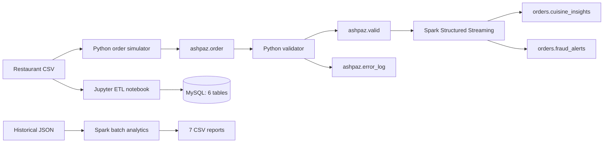
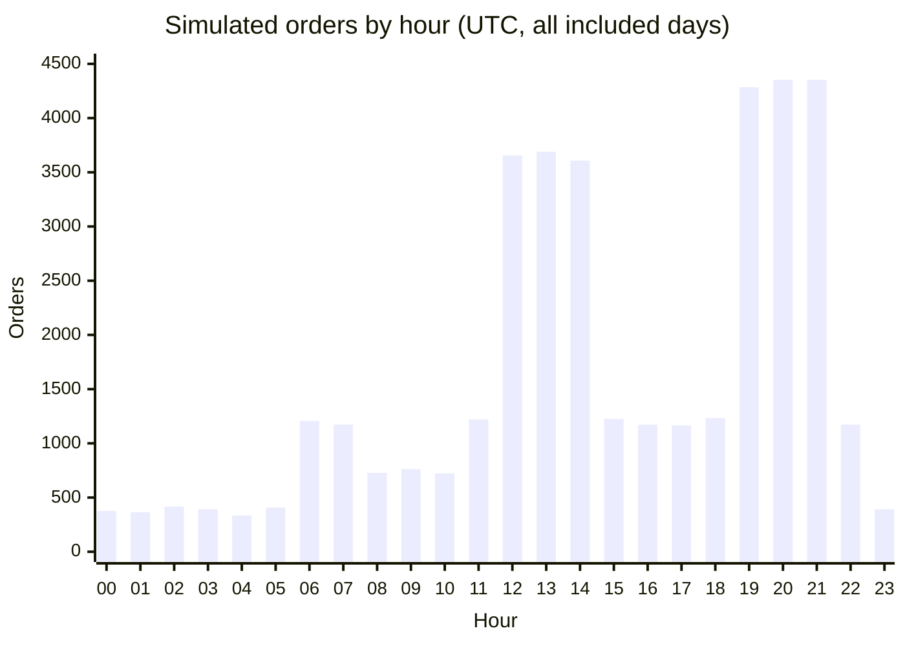

# Ashpaz | Real-Time Food Order Analytics

**From simulated restaurant orders to validated event streams, business insights, and suspicious-activity alerts.**

`Python` · `Apache Kafka` · `PySpark / Structured Streaming` · `MySQL` · `SQL` · `Jupyter`

Ashpaz explores a practical data engineering problem: how to turn a continuous stream of imperfect food orders into usable analytics. It combines relational restaurant modeling, configurable event simulation, Kafka-based validation, and Spark processing for historical analysis and live monitoring.

**At a glance:** 38,411 historical orders · 7 saved batch reports · 3 streaming queries · 6 relational tables

[Results](#results-from-the-included-data) · [Architecture](#how-it-works) · [Implementation](#what-is-implemented) · [Run locally](#run-locally) · [Engineering takeaways](#engineering-takeaways)

## How it works



The MySQL notebook is a separate modeling workflow. The producer reads the CSV directly; the streaming pipeline exchanges data through Kafka.

## What is implemented

| Component | Implementation | Technical focus |
| :--- | :--- | :--- |
| [Relational modeling](Part1.ipynb) | Six tables for locations, cuisines, services, restaurants, restaurant–cuisine relationships, and menu items; four SQL analyses | Foreign keys, many-to-many relationships, deduplication, bulk inserts, joins |
| [Order simulation](Ashpaz.py) | Nested JSON orders with weighted restaurant selection, time-dependent demand, accelerated event time, and configurable error injection | Probabilistic sampling, event generation, Kafka production |
| [Stream validation](TASK2%263/consumer.py) | Checks phone prefixes, conflicting order modes, and item-total consistency; routes accepted and rejected orders separately | Data quality rules, error classification, event routing |
| [Batch analytics](TASK2%263/Part3.py) | Item rankings, restaurant revenue, order-channel counts, hourly patterns, peak/off-peak hours, location revenue, and regional favorites | Nested-data processing, aggregation, ranking windows |
| [Streaming analytics](TASK2%263/Part3.py) | Cuisine analytics and two suspicious-activity checks with event-time windows, watermarks, and separate checkpoints | Stateful processing, micro-batches, Kafka output |

The notebook uses **pandas, PyMySQL, and SQLAlchemy**; the producer and validator use **confluent-kafka**. Spark uses explicit schemas and DataFrame transformations. Bundled Kafka connector JARs target Spark 3.5.0 / Scala 2.12. No MongoDB integration is implemented in the source.

### Live analytics and alert rules

| Query | Event-time window / slide | Output |
| :--- | :--- | :--- |
| Cuisine analytics | 1 minute / 20 seconds | Revenue, average order value, and order count per cuisine |
| Multiple-location activity | 30 minutes / 5 minutes | Flags a user ordering from more than one location label |
| Order velocity | 60 minutes / 5 minutes | Flags a user placing more than 5 orders |

All three queries use a **2-hour watermark**, a default **20-second processing trigger**, and update-mode output through `foreachBatch`. These are implementation settings, not measured latency guarantees. The multiple-location rule uses `restaurant_city` labels; it does not calculate distance or travel feasibility.

## Results from the included data

The repository contains **12,429 restaurant CSV rows** and **38,411 simulated historical orders**, spanning **4,595 restaurant IDs** and **30 location labels**. Restaurant IDs represent records, not necessarily deduplicated businesses.

### Order demand across the day



The saved [hourly counts](TASK2%263/outputs/part3_batch/hourly_order_patterns) match a direct count of the historical JSON. Lunch and evening peaks reflect the simulator's programmed demand pattern; they are not evidence of real customer behavior.

| Finding | Saved result | Interpretation |
| :--- | :--- | :--- |
| [Busiest hours](TASK2%263/outputs/part3_batch/peak_and_off_peak_hours) | 20:00 and 21:00 UTC: **4,352 orders each** | Preserves tied peaks; 04:00 is lowest with 334 orders |
| [Most ordered item](TASK2%263/outputs/part3_batch/top_ordered_items) | Coffee: **7,421 units**, **2,473 order lines** | Quantity and order-line counts answer different demand questions |
| [Highest-revenue restaurant record](TASK2%263/outputs/part3_batch/highest_revenue_restaurants) | YORK St.: **777,144.52**, **679 orders** | Combines order volume and value to rank restaurant records |
| [Highest-revenue location label](TASK2%263/outputs/part3_batch/revenue_distribution_by_city) | Marathahalli: **2,106,198.91**, **1,471 orders** | Demonstrates geographic grouping of order value |

Revenue figures use stored `order_price` values in the dataset's monetary units. Batch processing reads historical data directly and does **not** apply the Kafka validator, so injected price anomalies can affect totals.

The notebook preserves a load of **12,429 restaurant records** and **6,274 distinct service combinations**, plus SQL results for delivery listings, online-order pricing, neighborhood ratings, and price tiers. Its high-rating neighborhood query returned no qualifying rows under the selected thresholds.

**Evidence boundary:** these are descriptive analytics over simulated orders and saved notebook outputs. The repository does not report trained models, predictive accuracy, comparative benchmarks, or measured streaming performance.

## Engineering takeaways

The implementation demonstrates practical work with recurring data engineering challenges:

- **Messy source data:** parsing menu lists, handling missing ratings and costs, and separating repeated attributes into relational tables.
- **Nested events and schema variation:** explicit Spark schemas, item-array expansion, alternate item-name fields, and timestamp parsing with a Kafka timestamp fallback in streaming mode.
- **Event time versus processing time:** accelerated simulation, sliding windows, watermarks, and per-query checkpoints make time semantics central to the design.
- **Quality checks before analytics:** rejected orders retain their original payload and validation reasons for inspection.

Important trade-offs are visible in the code. Cuisine analytics attributes an order's full value to every listed cuisine, so totals across cuisines are not additive. Sliding windows and update-mode writes can emit multiple records for the same logical window; Kafka output has no application-level deduplication. Checkpoints therefore do not establish end-to-end exactly-once delivery.

Natural next steps are automated validation tests, malformed-event handling, menu-membership checks, and idempotent downstream storage. The simulator injects menu violations, but the validator checks only phone prefixes, order-mode conflicts, and price consistency.

## Run locally

Services are configured manually; there is no Docker Compose stack or dependency lockfile. Run commands from the repository root in a Java/Spark environment compatible with **Spark 3.5.0** and Scala 2.12 connectors.

### 1. Explore historical analytics

Install dependencies in a Python virtual environment:

```sh
python -m pip install pyspark==3.5.0 confluent-kafka
```

Run batch analytics without Kafka or MySQL:

```sh
spark-submit --master "local[*]" "TASK2&3/Part3.py" --mode batch --historical historical_data.json --output-dir outputs/part3_batch
```

This prints results and writes seven report directories, each containing a CSV part file. Selected output directories are overwritten on reruns. Previously saved results are under [`TASK2&3/outputs/part3_batch`](TASK2%263/outputs/part3_batch).

### 2. Start the streaming pipeline

Start Kafka at `localhost:9092` and create these topics with your Kafka installation's administration tools:

```text
ashpaz.order
ashpaz.valid
ashpaz.error_log
orders.cuisine_insights
orders.fraud_alerts
```

Start the validator and Spark job in separate terminals, then start the producer:

```sh
python "TASK2&3/consumer.py"
```

```sh
spark-submit --master "local[*]" --packages org.apache.spark:spark-sql-kafka-0-10_2.12:3.5.0 "TASK2&3/Part3.py" --mode streaming
```

```sh
python Ashpaz.py
```

The `--packages` option resolves the connector and its dependencies and requires repository access on first use. Spark starts at the latest Kafka offsets on a fresh checkpoint, so start it before generating orders. Inspect the insights, alerts, and error topics with a Kafka consumer.

<details>
<summary><strong>Configuration and notebook setup</strong></summary>

The producer accepts environment variables including `KAFKA_BROKER`, `KAFKA_TOPIC`, `RESTAURANT_CSV`, `EVENT_RATE`, `TIME_ACCELERATION`, `ERROR_RATE`, `PRICE_ERROR_RATE`, `MENU_VIOLATION_RATE`, `LOCATION_ANOMALY_RATE`, and `SPAM_USER_COUNT`. Spam-user weighting is disabled by default (`SPAM_USER_COUNT=0`). `EVENT_RATE` is a simulation input, not an achieved events-per-second metric.

Spark accepts `--bootstrap`, `--input-topic`, `--fraud-topic`, `--insights-topic`, `--checkpoint-dir`, and `--trigger`. The validator's broker and topics are constants in `consumer.py`; change those too when using a different broker.

For the optional MySQL notebook:

```sh
python -m pip install jupyter pandas pymysql sqlalchemy
```

Create a dedicated `ashpaz` database, update the notebook's connection settings, and add `import csv` before its CSV-loading cell. Use local credentials rather than the embedded example. **Schema setup drops and recreates six tables**, so use a disposable project database. The saved outputs reflect an earlier execution; a fresh kernel needs the missing import.

</details>

## Repository guide

```text
.
├── Ashpaz.py                   # Configurable Kafka order producer
├── Part1.ipynb                 # MySQL schema, CSV loading, SQL analysis
├── zomato.csv                  # Restaurant source records
├── historical_data.json        # Historical simulated orders
├── TASK2&3/
│   ├── consumer.py             # Validation and Kafka routing
│   ├── Part3.py                # Spark batch and streaming entry point
│   └── outputs/part3_batch/    # Seven saved CSV reports
├── jars/                      # Bundled JVM dependencies
├── CA2.pdf                    # Accompanying project document
└── CA2.zip                    # Archived project bundle
```

Start with the [saved results](TASK2%263/outputs/part3_batch) for a quick review, the [Spark implementation](TASK2%263/Part3.py) for processing logic, or the [notebook](Part1.ipynb) for relational modeling and SQL analysis.
